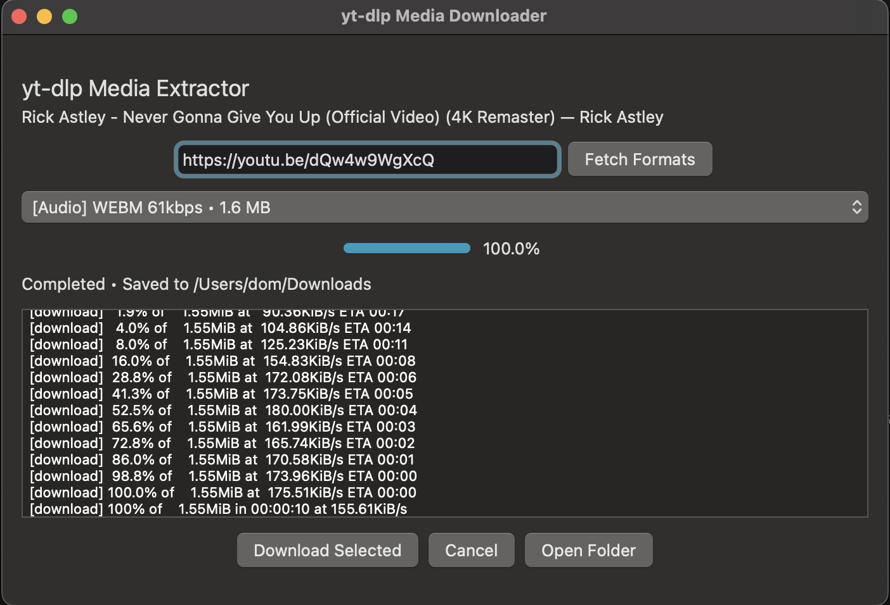

## Prerequisites

**`yt-dlp` is required** to fetch formats and download media:

```zsh
brew install yt-dlp
```

Optional, for merging separate video/audio streams and converting audio formats (such as M4A/MP3):

```zsh
brew install ffmpeg
```

## Usage

Inspect available video and audio streams and download media via the `ytp` keyword.


* <kbd>↩</kbd> Open the downloader window and automatically fetch formats if a URL is provided.

Alternatively, fetch formats and download media from a selected URL via the Universal Action.


Inside the downloader window, choose a quality preset or individual stream to start downloading with live progress and log output.




* <kbd>↩</kbd> Fetch formats for the entered URL.
* <kbd>⌘</kbd><kbd>F</kbd> Fetch formats.
* <kbd>⌘</kbd><kbd>D</kbd> Download selected format.
* <kbd>⌘</kbd><kbd>.</kbd> Cancel active download.
* <kbd>⌘</kbd><kbd>O</kbd> Open destination folder in Finder.
* <kbd>⌘</kbd><kbd>L</kbd> Show or hide logs.

Downloaded files are saved to the destination folder set in the Workflow's Configuration.

## Download options

Click **Options** to expand the cookie, speed, retry, subtitle, and embedding
controls. The panel starts collapsed. Hiding it preserves selections for the
current session, and those selections still apply to downloads. Browser/profile
choices remain remembered between launches. The log toggles independently.

The format picker includes MP4 presets capped at 2160p, 1080p, 720p, and 480p.
Each chooses an available resolution at or below the cap; individual stream
selections keep their exact format. A capped preset fails if no compatible
format at or below its limit is available.

- **Subtitles** writes available subtitle files. Languages default to `en.*`;
  use comma-separated language codes/patterns such as `en.*,ja`, or
  `all,-live_chat`. Blank language input uses `en.*`.
- **Include auto-generated** also requests automatic subtitles when Subtitles
  is enabled.
- **Embed in video** embeds the requested subtitles when Subtitles is enabled.
  Choose a video format supporting subtitles (MP4, WebM, or MKV).
- **Embed metadata** adds media tags. The existing M4A/MP3 audio presets always
  include metadata, independently of this checkbox.
- **Embed cover art** adds the thumbnail when supported by the output format.

Subtitle and embedding options apply to the next download and reset when the window reopens.
Subtitles and thumbnails depend on the source and selected output format.
Install `ffmpeg` for merging, audio conversion, and embedding.

Option names and language patterns follow the
[yt-dlp documentation](https://github.com/yt-dlp/yt-dlp#usage-and-options).

### Cookies, speed, and retries

The Cookies picker detects supported browsers installed in `/Applications`,
`~/Applications`, or `/System/Applications` on the Mac running the workflow.
The list is rebuilt each time the downloader opens; it is not tied to the
original developer's machine. **Cookies: None** is the default.

The narrower profile picker refreshes when you change browsers. It discovers
Chromium-based profiles from local profile metadata and directories, and
Firefox profiles from `profiles.ini` and the Profiles directory. **Profile:
Automatic** lets yt-dlp choose. Safari offers Automatic because yt-dlp does
not expose Safari's named profiles in the same way. Portable browsers,
renamed applications, and nonstandard profile locations may not be detected.
A previously saved custom profile is retained on launch.

The browser and profile are remembered between launches. Select None to stop
using browser cookies. Changing the browser/profile does not fetch anything;
press Fetch Formats again to load formats using the new session. Discovery
reads only application locations and profile metadata, not cookie databases.

Cookies are passed to yt-dlp for both metadata fetching and downloading;
the workflow stores only the browser/profile selection, not cookie values.
Browser access may require macOS permission or Keychain approval. Sign in to
the media site in the selected browser first.

**Speed limit** accepts values such as `500K` or `5M` (bytes per second);
blank leaves yt-dlp's default. **Retries** accepts 0–9999 and applies to both
file and fragment retries. Blank leaves yt-dlp's default. Speed and retries
reset on reopening. These controls follow the
[yt-dlp options](https://github.com/yt-dlp/yt-dlp#usage-and-options).

### Destination, history, and clips

In **Options**, **Save to** shows the current destination. **Choose…** opens
macOS's folder chooser and remembers your choice for later launches. **Default**
clears this override and uses Output Destination from Workflow Configuration
(`~/Downloads` unless changed). Folder changes are blocked during a download.

**Skip downloaded** remembers successful full-video downloads in
`.yt-dlp-archive.txt` inside the chosen folder. It only knows downloads recorded
while enabled; it does not scan existing files. It skips the same video even
when another format is selected, and keeps skipping if its media file is later
deleted. Uncheck it to download that video again. The checkbox is remembered.

**Start** and **End** select a clip using seconds, `MM:SS`, or `HH:MM:SS` (up to
millisecond precision). Both blank downloads the full video; a blank start
means 0, and a blank end means the end of the video. End must follow start.
Clips require ffmpeg and use a `[clip start-end]` filename suffix. They neither
read nor update full-video download history. Clip times reset when reopening.
Cuts use yt-dlp/ffmpeg's default behavior and may follow nearby keyframes;
frame-accurate cuts are not enabled.
