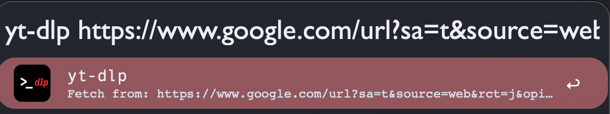

## Prerequisites

**`yt-dlp` is required** to fetch formats and download media:

```zsh
brew install yt-dlp
```

Optional, for merging separate video/audio streams and converting audio formats (such as M4A/MP3):

```zsh
brew install ffmpeg
```

## Usage

Inspect available video and audio streams and download media via the `ytp` keyword.



* <kbd>↩</kbd> Open the downloader window and automatically fetch formats if a URL is provided.

Alternatively, fetch formats and download media from a selected URL via the Universal Action.


Inside the downloader window, choose a quality preset or individual stream to start downloading with live progress and log output.


* <kbd>↩</kbd> Fetch formats for the entered URL.
* <kbd>⌘</kbd><kbd>F</kbd> Fetch formats.
* <kbd>⌘</kbd><kbd>D</kbd> Download selected format.
* <kbd>⌘</kbd><kbd>.</kbd> Cancel active download.
* <kbd>⌘</kbd><kbd>O</kbd> Open destination folder in Finder.

Downloaded files are saved to the destination folder set in the Workflow's Configuration.
