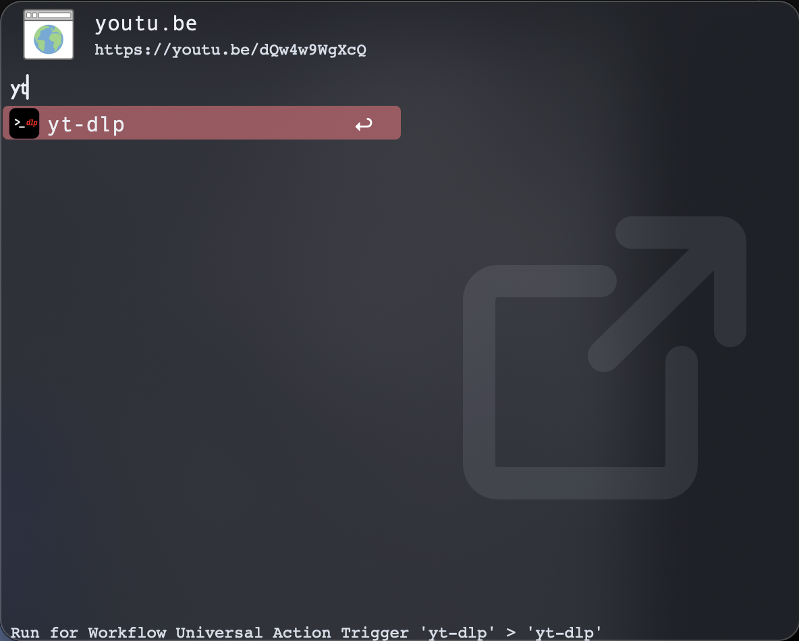
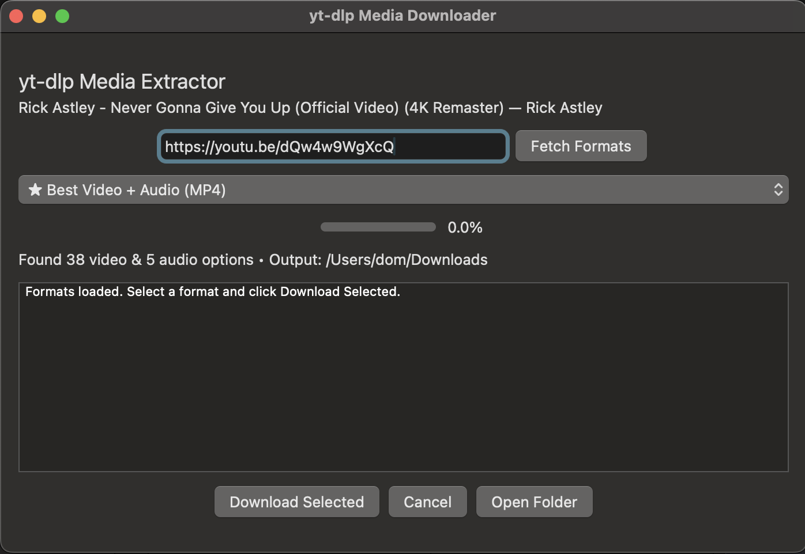

## Prerequisites

**`yt-dlp` is required** to fetch formats and download media:

```zsh
brew install yt-dlp
```

Optional, for merging separate video/audio streams and converting audio formats (such as M4A/MP3):

```zsh
brew install ffmpeg
```

## Usage

Inspect available video and audio streams and download media via the `ytp` keyword.


* <kbd>↩</kbd> Open the downloader window and automatically fetch formats if a URL is provided.

Alternatively, fetch formats and download media from a selected URL via the Universal Action.



Inside the downloader window, choose a quality preset or individual stream to start downloading with live progress and log output.




* <kbd>↩</kbd> Fetch formats for the entered URL.
* <kbd>⌘</kbd><kbd>F</kbd> Fetch formats.
* <kbd>⌘</kbd><kbd>D</kbd> Download selected format.
* <kbd>⌘</kbd><kbd>.</kbd> Cancel active download.
* <kbd>⌘</kbd><kbd>O</kbd> Open destination folder in Finder.
* <kbd>⌘</kbd><kbd>L</kbd> Show or hide logs.

Downloaded files are saved to the destination folder set in the Workflow's Configuration.

## Automatic URL selection

An explicitly supplied URL takes priority. When opened without one, the workflow
fills the URL field from the current tab of the front supported browser, then
from the current clipboard, then from the newest link among the 20 most recent
Alfred Clipboard History entries. Links inside copied text are accepted. The
selected URL waits for Return or Fetch Formats; no download starts automatically.

Browser detection uses Alfred's Core Automation Tasks (install/update them in
Alfred Preferences → Workflows → Automation Task Options). Supported browsers
follow the Current Front Browser Tab task, including Safari and Chromium-based
browsers such as Chrome, Brave and Edge. It may request macOS Automation access.
An unavailable browser/task, a non-web tab, or denied access falls back to the
clipboard. Firefox is not supported by that browser task. Clipboard History must
be enabled for older items; the current clipboard works independently.

History contents are resolved through Alfred placeholders at workflow launch,
then discarded from the workflow's variables after selecting a link. The
clipboard itself is not changed, and the workflow does not read Alfred's database.

A small caption below the URL identifies its source: Browser tab, Clipboard,
Clipboard history, or Entered URL. Editing the field changes the caption to
Entered URL.
